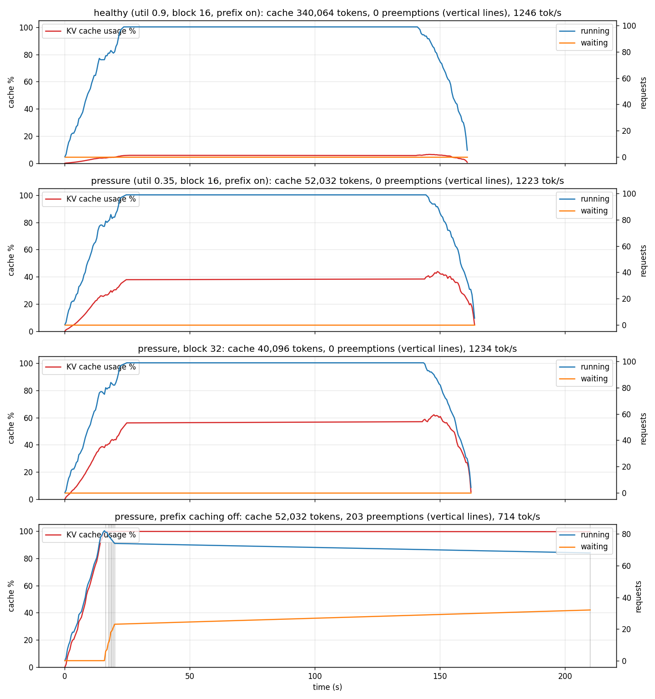

# Report: vLLM's block manager under memory pressure (Tesla T4, vLLM 0.31.0, Qwen2.5-1.5B-Instruct FP16)

Four configurations, same load each time: open loop at 6 requests/s for 90 s, 512-token prompts, exactly 384 output tokens, `max-model-len 2048`, `max-num-seqs 256`; `/metrics` sampled every 0.5 s. Raw data: `results/kaggle_run1/`.

| config | kv_tokens | preemptions | events | full_pct | peak_waiting | tok_s | tok_s_steady | tok_s_after_preempt | ttft_p50_ms | itl_p50_ms | itl_p99_ms | e2e_p95_s | requests | errors |
|---|---|---|---|---|---|---|---|---|---|---|---|---|---|---|
| healthy (util 0.9, block 16, prefix on) | 340064 | 0 | 0 | 0 | 0 | 1246 | 1045 | 0 | 20102 | 74.2 | 150 | 73.3 | 522 | 0 |
| pressure (util 0.35, block 16, prefix on) | 52032 | 0 | 0 | 0 | 0 | 1223 | 1024 | 0 | 21695 | 75.9 | 153 | 76.4 | 522 | 0 |
| pressure, block 32 | 40096 | 0 | 0 | 0 | 0 | 1234 | 1026 | 0 | 21663 | 74.4 | 146 | 75.0 | 522 | 0 |
| pressure, prefix caching off | 52032 | 203 | 8 | 24 | 32.0 | 714 | 387 | 1302 | 46537 | 61.8 | 486 | 134.1 | 522 | 171 |

Columns: `tok_s` is mean output tokens/s over the level; `tok_s_steady` excludes the 4 s around each preemption burst and `tok_s_after_preempt` is the rate in the 2 s after one; `full_pct` is the share of samples with KV usage ≥ 98%; `errors` are client-side request timeouts (120 s).

## 1. Two configurations that were meant to be under pressure were not

`--gpu-memory-utilization 0.35` cut the cache from 340,064 to 52,032 tokens, and ~100 requests of ~900 tokens each were in flight (90k tokens of context), yet KV usage peaked at 44% and nothing was preempted. The reason is the same one kvcalc found: vLLM 0.31 enables **prefix caching** by default and every request carried the *same* 512-token prompt, so the prompt's 32 blocks existed once and were shared; each request only needed blocks for its own generated tokens, on average half-written. 100 x 192 + 512 ≈ 20k tokens ≈ 38% of the cache: what the timeline shows. A memory-pressure experiment with identical prompts measures the prefix cache, not the block manager. The fourth configuration, with prefix caching off, is the real experiment.

## 2. The pressure signature, when it appears

With prefix caching off and the same 52k-token cache:

- KV usage reached 100% at t ≈ 15 s and stayed pinned there for the rest of the run.
- **203 preemptions in 8 bursts**, the first at t = 16.3 s, each followed by `running` dropping and `waiting` climbing (0 → 32): the saw-tooth from CONCEPTS.md section 4.
- Throughput fell from ~1,220 to **714 tok/s (−42%)**; the steady-state rate between bursts was only 387 tok/s against 1,302 tok/s right after a burst, which is the recompute cost showing: freed memory lets the batch run fast for a moment, then the preempted requests' prefills (prompt + everything generated so far) consume the iterations again.
- Per-token stalls: ITL p99 486 ms against a p50 of 62 ms (8x), versus 150/74 ms in the healthy run.
- 171 of 522 requests timed out at 120 s on the client; E2E p95 134 s.

The scheduler did what the paper says: under memory pressure it evicts the most recently admitted sequences, keeps the oldest running, and re-prefills the evicted ones when space returns. The cost is not subtle.

## 3. Block size 32 cost capacity, not just waste

Changing `--block-size` from 16 to 32 reduced the reported KV cache from 52,032 to **40,096 tokens (−23%)** at the same memory budget (1.39 → 1.07 GiB available). That is far more than the tail-block waste bound in CONCEPTS.md section 1; on this stack (TRITON_ATTN on a Turing GPU) the larger block size changes the profiled activation/workspace reservation taken before the cache is sized. The run itself behaved identically (no preemptions, same throughput) because, as in section 1, the shared prompt kept usage low. The honest conclusion is narrower than planned: on a T4 with vLLM 0.31, block 32 buys nothing measurable and costs a quarter of the cache.

## 4. A measurement artifact, named

`running` plateaued at exactly 99–100 in every configuration and the healthy baseline shows a 20 s median TTFT. That is not the server: tokenbench's HTTP client used httpx's default pool of 100 connections, so arrivals beyond 100 in flight queued inside the client. The 6 req/s x 896-token load also exceeds this GPU's ~1,250 tok/s, so a backlog would have formed anyway, but the *measured* TTFT in the healthy run is the client's queue, not vLLM's. tokenbench's pool is now 2,000; the four configurations here shared the artifact equally, so their comparison stands, and TTFT is not used to draw conclusions.

## 5. What the metrics timeline could not show

The 0.5 s sampler thinned out after t ≈ 22 s in the preemption run (the sparse tail of the fourth panel): under preemption churn, with ~200 client tasks live, the sampler coroutine was starved of event-loop time. The per-request numbers are unaffected; the timeline after 22 s is a line between two samples, not a measurement.

## Lessons

1. A KV-cache experiment needs **distinct prompts** (or `--no-enable-prefix-caching`), otherwise the cache never fills.
2. Preemption under vLLM V1 is expensive: throughput −42%, ITL p99 x3, and a third of requests lost at a 120 s timeout. `num_preemptions_total` climbing is a capacity alarm, not a curiosity.
3. Block size is not a free knob on every stack; measure the reported capacity after changing it.
4. Measure the client before trusting a latency number (connection pools, event-loop starvation).
